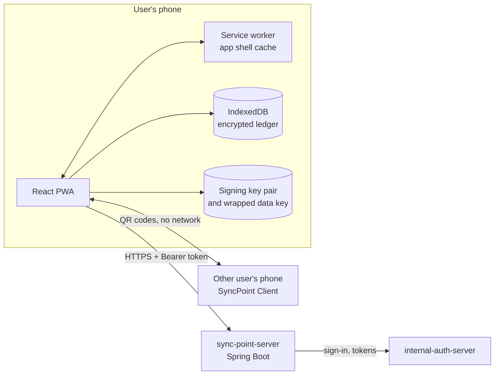
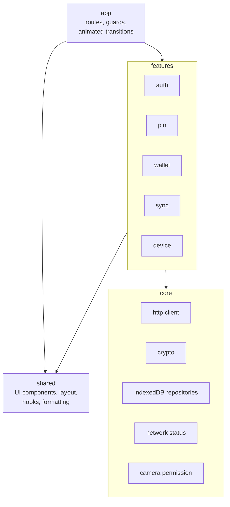
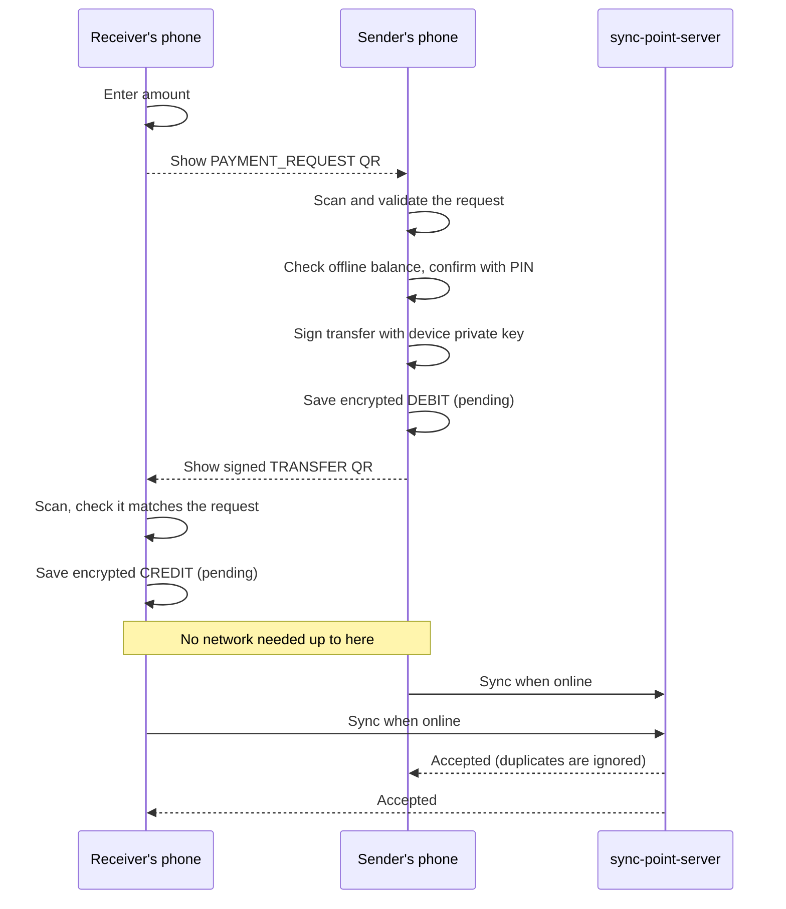
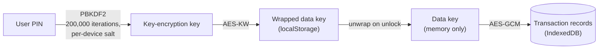

<div align="center">

# SyncPoint Client

**The installable web app for SyncPoint, an offline-first wallet. Two people can pay each other by scanning QR codes with no internet connection, and the app syncs every signed transfer to the server once it is back online.**

[](#technology-stack)
[](#technology-stack)
[](#offline-and-pwa)
[](#local-storage-and-encryption)
[](#transfer-signing)

</div>

---

## Table of Contents

1. [Project Overview](#project-overview)
2. [The Problem](#the-problem)
3. [The Solution](#the-solution)
4. [Features](#features)
5. [Technology Stack](#technology-stack)
6. [System Architecture](#system-architecture)
7. [Client Architecture](#client-architecture)
8. [Folder Structure](#folder-structure)
9. [Offline Payment Flow](#offline-payment-flow)
10. [Transfer Signing](#transfer-signing)
11. [Local Storage and Encryption](#local-storage-and-encryption)
12. [Sync](#sync)
13. [Offline and PWA](#offline-and-pwa)
14. [Session and Device Safety](#session-and-device-safety)
15. [Configuration](#configuration)
16. [Running Locally](#running-locally)
17. [Deployment](#deployment)
18. [Author](#author)

---

## Project Overview

SyncPoint Client is a React progressive web app. Users move money from their online balance into an offline wallet on the phone, then pay or get paid face to face by QR code, with neither phone needing a connection. Each payment is signed on the sender's device, stored encrypted on both devices, and pushed to [sync-point-server](https://github.com/EzeDev98/sync-point-server) by whichever device reaches the network first.

## The Problem

- **Payments stop when the network does.** Most wallets need a live connection for every transfer.
- **A phone is not a safe place to keep money records.** Anything stored in the browser can be read or edited by someone holding the device.
- **Offline payments are easy to fake.** With no server in the loop, a receiver has no way to know a transfer is genuine.
- **Data loss means money loss.** Clearing storage, updating the app or a session expiring could wipe unsynced payments.

## The Solution

- **QR handshake.** The receiver shows a payment request QR, and the sender scans it, confirms with their PIN and shows a signed transfer QR back.
- **Device signatures.** Each device holds an ECDSA P-256 key pair whose public key is registered with the server. The server rejects any transfer the sender did not sign.
- **Encrypted local ledger.** Every transaction is stored in IndexedDB encrypted with AES-GCM under a key that only the user's PIN can unlock.
- **Derived balance.** The offline balance is never stored. It is always recalculated from the ledger, so the two can never disagree.
- **Guarded wipes.** Sign-out, PIN reset and app updates are blocked while the device holds unsynced transfers or offline funds. An expired session quarantines local data instead of deleting it.

## Features

- Installable PWA with a compatibility check and an install flow
- Registration with phone verification by OTP
- Sign-in, password reset by OTP and automatic token refresh
- Wallet PIN: set, change, verify and reset by OTP
- PIN unlock that works offline, with an auto-lock when the app goes to the background
- Moving funds between the online account and the offline wallet
- Sending and receiving payments by QR code with no connection
- Encrypted local transaction ledger and a balance derived from it
- Automatic sync when the connection returns and every 10 minutes
- Notifications and full transaction history
- Update detection with a prompt to load the new build, offered only when wiping is safe
- Quarantine and restore of local data when a session expires
- Works fully offline once installed

## Technology Stack

| Area | Technology |
|---|---|
| UI | React 19, CSS Modules with shared design tokens |
| Routing | React Router 7 |
| Build | Vite 8 |
| Offline | Service worker, Web App Manifest |
| Local storage | IndexedDB |
| Cryptography | WebCrypto: ECDSA P-256, AES-GCM, AES-KW, PBKDF2 |
| QR codes | qrcode.react (display), html5-qrcode (scanning) |
| Icons | lucide-react |
| Lint | ESLint 10 with React Hooks rules |

## System Architecture



The client only ever talks to sync-point-server. The server handles all calls to internal-auth.

## Client Architecture

The code is organised by feature. `app` wires the routes and guards, each `features/*` folder holds its own pages, API calls, services and state, `core` holds the low-level building blocks, and `shared` holds reusable UI and helpers.



Every route is declared once in `AppRouter.jsx` with its guards: install (the app must be installed as a PWA) and unlock (the wallet must be unlocked with the PIN).

## Folder Structure

```
sync-point-client/
├── public/
│   ├── sw.js                # Service worker
│   ├── manifest.json        # PWA manifest
│   ├── offline.html         # Fallback page when nothing is cached
│   └── icons/
├── scripts/
│   └── generate-icons.mjs   # Builds the PWA icon set
├── src/
│   ├── app/                 # App shell, router, guards
│   ├── core/
│   │   ├── camera/          # Camera permission
│   │   ├── crypto/          # Keys, encryption, transfer signatures
│   │   ├── db/              # IndexedDB schema and repositories
│   │   ├── http/            # HTTP client and API errors
│   │   └── network/         # Connectivity status
│   ├── features/
│   │   ├── auth/            # Registration, sign-in, password reset
│   │   ├── device/          # Install, compatibility, updates, quarantine
│   │   ├── pin/             # Set, change, verify and reset the PIN
│   │   ├── sync/            # Pushing transactions to the server
│   │   └── wallet/          # Dashboard, funding, send, receive, history
│   ├── shared/              # UI components, layout, hooks, utils
│   ├── styles/              # Reset, design tokens, base styles
│   └── main.jsx
├── index.html
└── vite.config.js
```

## Offline Payment Flow



Both phones keep the signed transfer, so the payment settles as soon as either one reaches the server.

## Transfer Signing

- At sign-in, a device without a signing key creates an ECDSA P-256 key pair and registers the public key with `POST /wallet/signing-key`.
- The private key never leaves the device and is stored in its own IndexedDB database.
- The sender signs a canonical string at PIN time:

  ```
  SYNCPOINT-TRANSFER|v1|{transactionRef}|{requestRef}|{senderWalletId}|{receiverWalletId}|{amountInKobo}|{currency}|{createdAtEpochMillis}
  ```

- Amounts are integer kobo and times are epoch milliseconds, so the string is byte-for-byte identical on the client and the server.
- The signature is raw P1363 (`r||s`) in base64, which the server verifies with `SHA256withECDSAinP1363Format`.

## Local Storage and Encryption



- Every transaction is encrypted before it is written. Only fields needed for querying, such as status and sync state, stay readable.
- The unwrapped data key exists only in memory and is never written to storage.
- Changing the PIN only re-wraps the data key, so existing records stay readable.
- The PIN can be checked offline against a stored verifier, so the wallet unlocks without a connection.

## Sync

- Pending transactions are sent to `POST /wallet/sync-transaction` in batches of three, so a failure only affects a few transactions.
- Sync runs when the connection returns and every 10 minutes while the app is open.
- Transfers the server accepted or had already processed are marked synced. Rejected ones, such as a bad signature, are marked failed and their amount returns to the offline balance.
- A network failure stops the run without settling anything, and the rest is retried next time.
- Transaction references make retries safe: a transfer synced by both phones is only recorded once.

## Offline and PWA

- The service worker precaches the app shell and every hashed JS and CSS file at build time, so the whole app loads with no connection.
- `vite.config.js` stamps each build with a unique id, writes `version.json` and injects the asset list into `sw.js`.
- The app polls for a new build every 3 minutes and offers the update only when the device holds nothing unsynced.
- Install is required before the wallet can be used, because offline operation depends on the service worker and standalone display mode.

## Session and Device Safety

- Access tokens live in session storage and are refreshed automatically. Identity data and the wrapped key live in local storage.
- The wallet locks when the app goes to the background and asks for the PIN on return.
- Sign-out is refused while the device holds unsynced transfers or offline funds, because sign-out makes local records unreadable.
- When a session expires, local data is quarantined, still encrypted, and restored when the same account signs back in on the same device.
- Forgot-PIN is blocked while transfers are unsynced.

## Configuration

| Variable | Purpose |
|---|---|
| `VITE_API_URL` | sync-point-server base URL, e.g. `https://api.example.com/api/v1`. Defaults to `http://localhost:2000/api/v1`. |

Put it in `.env`, or in `.env.local` to override it on your machine only. Both are git-ignored.

## Running Locally

Requirements: Node.js 20 or later and a running sync-point-server.

```bash
git clone https://github.com/EzeDev98/sync-point-client.git
cd sync-point-client
npm install
npm run dev
```

The app runs on `http://localhost:3030`.

| Script | Description |
|---|---|
| `npm run dev` | Start the dev server on port 3030 |
| `npm run build` | Production build into `dist/` |
| `npm run preview` | Serve the production build |
| `npm run lint` | Run ESLint |
| `npm run generate-icons` | Regenerate the PWA icons |

The service worker and install flow only behave like production on a build. Use `npm run build && npm run preview` to test them.

## Deployment

`npm run build` produces a static site in `dist/`. `public/_redirects` sends every path to `index.html`, so client-side routes work on Netlify-style hosts. Serve it over HTTPS, which is required for the service worker, camera access and WebCrypto.

## Author

**Eze Moses John**
Built by Building with Eze.
EOFcat >> README.md <<'EOF'
## Folder Structure

```
sync-point-client/
├── public/
│   ├── sw.js                # Service worker
│   ├── manifest.json        # PWA manifest
│   ├── offline.html         # Fallback page when nothing is cached
│   └── icons/
├── scripts/
│   └── generate-icons.mjs   # Builds the PWA icon set
├── src/
│   ├── app/                 # App shell, router, guards
│   ├── core/
│   │   ├── camera/          # Camera permission
│   │   ├── crypto/          # Keys, encryption, transfer signatures
│   │   ├── db/              # IndexedDB schema and repositories
│   │   ├── http/            # HTTP client and API errors
│   │   └── network/         # Connectivity status
│   ├── features/
│   │   ├── auth/            # Registration, sign-in, password reset
│   │   ├── device/          # Install, compatibility, updates, quarantine
│   │   ├── pin/             # Set, change, verify and reset the PIN
│   │   ├── sync/            # Pushing transactions to the server
│   │   └── wallet/          # Dashboard, funding, send, receive, history
│   ├── shared/              # UI components, layout, hooks, utils
│   ├── styles/              # Reset, design tokens, base styles
│   └── main.jsx
├── index.html
└── vite.config.js
```

## Offline Payment Flow


Both phones keep the signed transfer, so the payment settles as soon as either one reaches the server.

## Transfer Signing

- At sign-in, a device without a signing key creates an ECDSA P-256 key pair and registers the public key with `POST /wallet/signing-key`.
- The private key never leaves the device and is stored in its own IndexedDB database.
- The sender signs a canonical string at PIN time:

  ```
  SYNCPOINT-TRANSFER|v1|{transactionRef}|{requestRef}|{senderWalletId}|{receiverWalletId}|{amountInKobo}|{currency}|{createdAtEpochMillis}
  ```

- Amounts are integer kobo and times are epoch milliseconds, so the string is byte-for-byte identical on the client and the server.
- The signature is raw P1363 (`r||s`) in base64, which the server verifies with `SHA256withECDSAinP1363Format`.

## Local Storage and Encryption


- Every transaction is encrypted before it is written. Only fields needed for querying, such as status and sync state, stay readable.
- The unwrapped data key exists only in memory and is never written to storage.
- Changing the PIN only re-wraps the data key, so existing records stay readable.
- The PIN can be checked offline against a stored verifier, so the wallet unlocks without a connection.

## Sync

- Pending transactions are sent to `POST /wallet/sync-transaction` in batches of three, so a failure only affects a few transactions.
- Sync runs when the connection returns and every 10 minutes while the app is open.
- Transfers the server accepted or had already processed are marked synced. Rejected ones, such as a bad signature, are marked failed and their amount returns to the offline balance.
- A network failure stops the run without settling anything, and the rest is retried next time.
- Transaction references make retries safe: a transfer synced by both phones is only recorded once.

## Offline and PWA

- The service worker precaches the app shell and every hashed JS and CSS file at build time, so the whole app loads with no connection.
- `vite.config.js` stamps each build with a unique id, writes `version.json` and injects the asset list into `sw.js`.
- The app polls for a new build every 3 minutes and offers the update only when the device holds nothing unsynced.
- Install is required before the wallet can be used, because offline operation depends on the service worker and standalone display mode.

## Session and Device Safety

- Access tokens live in session storage and are refreshed automatically. Identity data and the wrapped key live in local storage.
- The wallet locks when the app goes to the background and asks for the PIN on return.
- Sign-out is refused while the device holds unsynced transfers or offline funds, because sign-out makes local records unreadable.
- When a session expires, local data is quarantined, still encrypted, and restored when the same account signs back in on the same device.
- Forgot-PIN is blocked while transfers are unsynced.

## Configuration

| Variable | Purpose |
|---|---|
| `VITE_API_URL` | sync-point-server base URL, e.g. `https://api.example.com/api/v1`. Defaults to `http://localhost:2000/api/v1`. |

Put it in `.env`, or in `.env.local` to override it on your machine only. Both are git-ignored.

## Running Locally

Requirements: Node.js 20 or later and a running sync-point-server.

```bash
git clone https://github.com/EzeDev98/sync-point-client.git
cd sync-point-client
npm install
npm run dev
```

The app runs on `http://localhost:3030`.

| Script | Description |
|---|---|
| `npm run dev` | Start the dev server on port 3030 |
| `npm run build` | Production build into `dist/` |
| `npm run preview` | Serve the production build |
| `npm run lint` | Run ESLint |
| `npm run generate-icons` | Regenerate the PWA icons |

The service worker and install flow only behave like production on a build. Use `npm run build && npm run preview` to test them.

## Deployment

`npm run build` produces a static site in `dist/`. `public/_redirects` sends every path to `index.html`, so client-side routes work on Netlify-style hosts. Serve it over HTTPS, which is required for the service worker, camera access and WebCrypto.

## Author

**Eze Moses John**
Built by Building with Eze.
